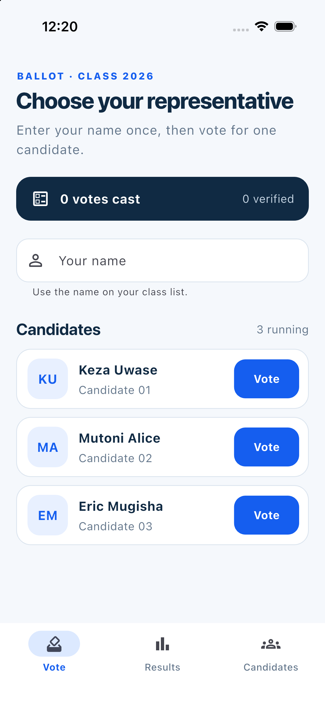
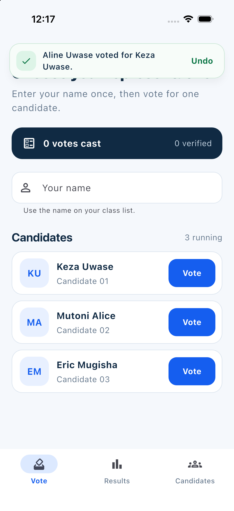
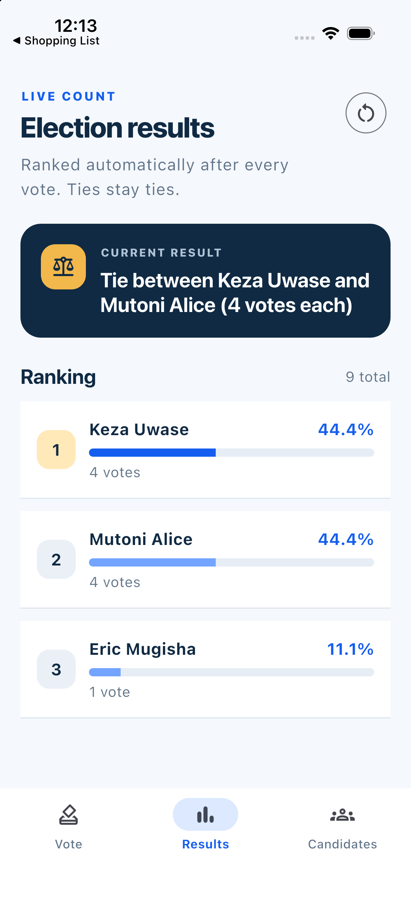
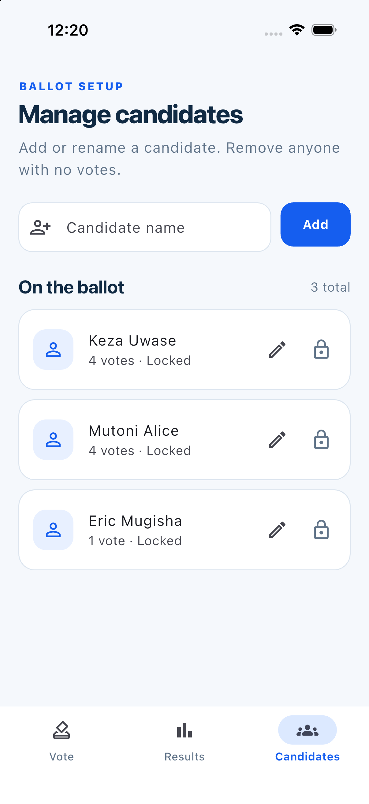

# Ballot — Class Election

Ballot is the **Class Election** project from Week 2, Session 4. It gives a class a simple, honest way to vote once, see ranked results, preserve ties, and manage the ballot without a backend.

## Features

- Three screens: Vote, Results, and Candidates.
- Three sample candidates on first launch.
- Cleans every voter and candidate name by trimming spaces, collapsing repeated spaces, and applying Title Case.
- Treats names case-insensitively, so ` aline ` and `ALINE` are the same voter.
- Allows each cleaned voter name to vote only once.
- Supports Undo for the latest vote.
- Ranks candidates by votes, shows one-decimal percentages, and keeps equal scores tied.
- Shows **No votes yet** before the first vote instead of dividing by zero.
- Supports candidate create, read, edit, and delete operations.
- Refuses empty and duplicate candidate names during both add and edit.
- Prevents removing a candidate who already has votes.
- Resets all votes only after a clear confirmation dialog.
- Uses accessible labels, large touch targets, responsive content widths, and reduced-motion-aware floating notices.
- Includes a pulsing startup skeleton, animated screen changes, tactile vote feedback, and animated result bars.

## Screenshots

Screenshots are stored in `screenshots/`:

| Vote | Vote confirmation |
| --- | --- |
|  |  |

| Results | Candidates |
| --- | --- |
|  |  |

## Think

### 1. Why must names be cleaned before they are compared?

People type the same name in different ways. Without cleaning, ` aline `, `ALINE`, and `Aline` would look like three different voters, so one person could vote more than once. The app trims outside spaces, replaces repeated inside spaces with one space, converts the name to Title Case for display, and compares a lowercase version.

### 2. How does the app decide between a winner and a tie?

The app ranks candidates from the highest vote count to the lowest. It takes the top score and finds every candidate with that score. One candidate means there is a winner; two or more means there is a tie, so every tied name is shown instead of inventing a winner.

## How the rules are organized

All election rules live in `ElectionController`, outside widget `build` methods. Screens call functions such as `vote`, `addCandidate`, `removeCandidate`, `undoLastVote`, and `resetVotes`, then render the controller's current data.

## Run

```sh
flutter pub get
flutter run
```

## Documentation

- [Architecture and business rules](docs/ARCHITECTURE.md)
- [Requirements and acceptance checklist](docs/REQUIREMENTS.md)

## Verify

```sh
flutter analyze
flutter test
flutter build ios --simulator
```
